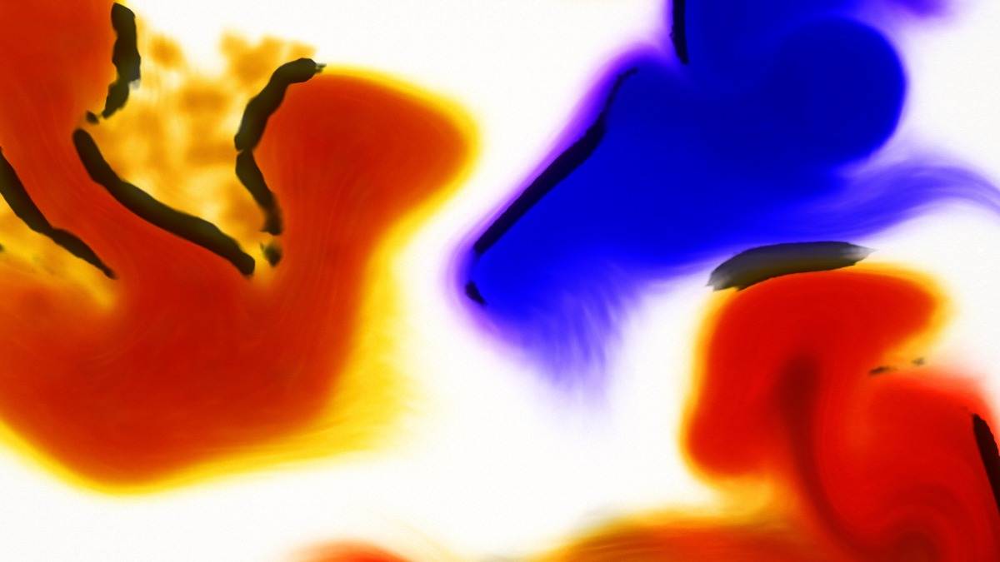
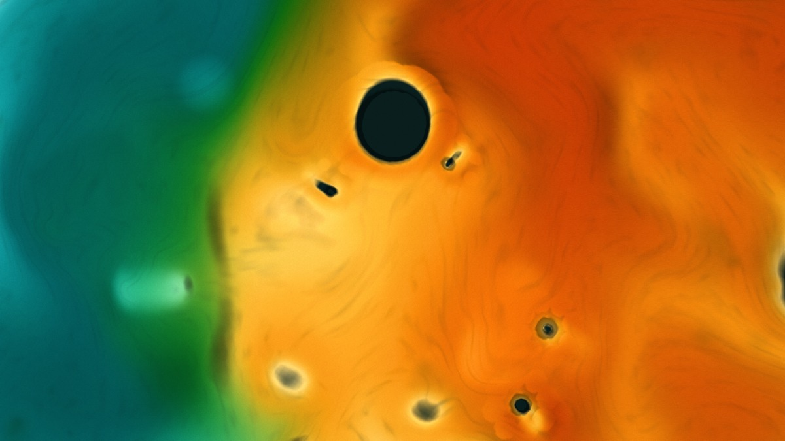
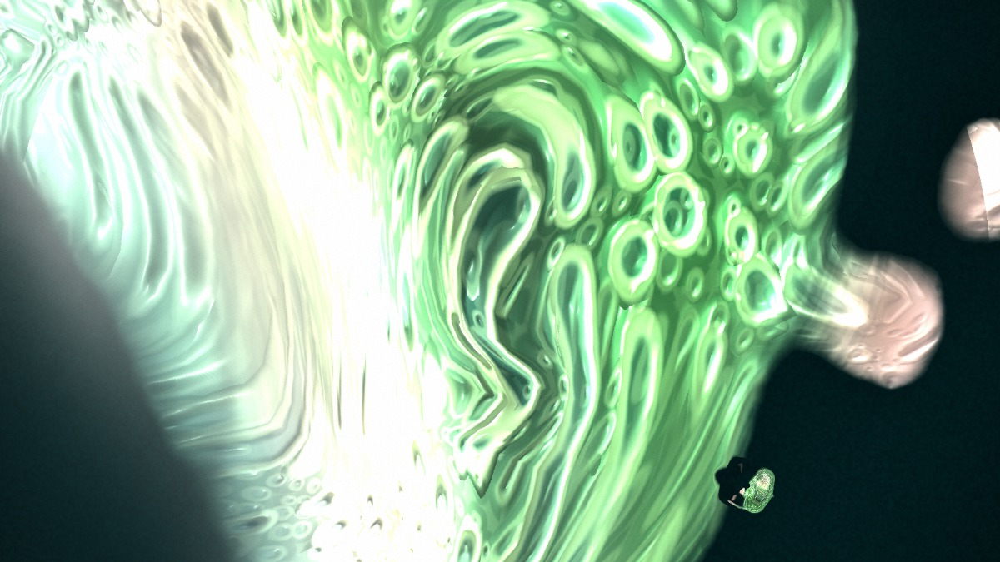
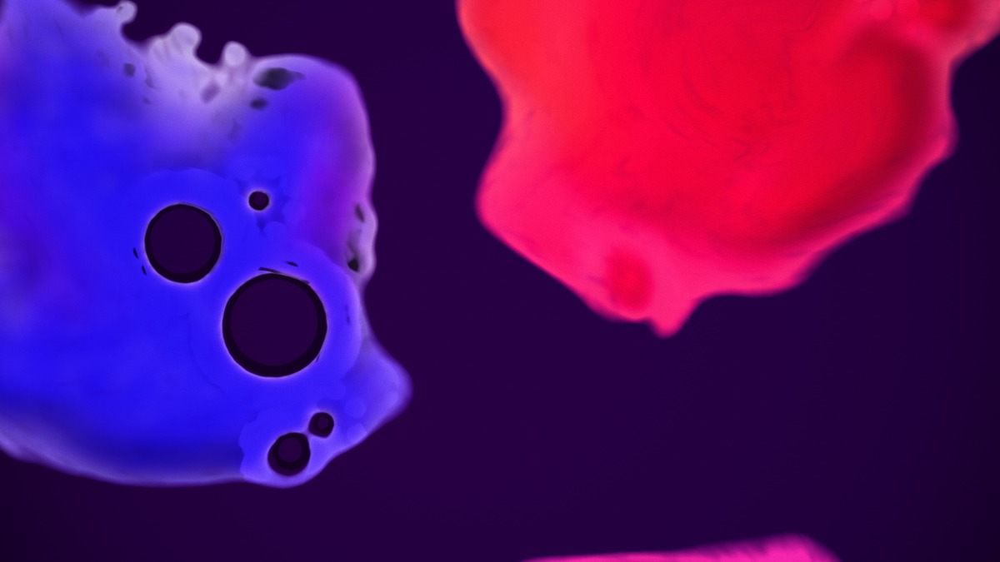

# ChromaGlass

A liquid light show you play. Colored oils squeezed between glass plates, heated from below and projected on a wall, the way the 1960s shows did it, rebuilt as a real-time fluid simulation that runs on your GPU and listens to the music.

**[Open it →](https://chromaglass.art)** It needs no microphone and no permission to show you what it is: a synthesised band plays itself into the show on your first click.

| | |
|---|---|
|  |  |
| *Poster, 1969*: two opaque dyes on a single plate, hard-edged and flat like a screen-printed Fillmore poster | *Oil & Water*: amber oil on teal water between two glasses, each keeping its own colour as bodies round up and merge |
|  |  |
| *Macro Bead*: a tracking camera chasing a single bead at high magnification | *Velvet Underground*: three pools apart on deep violet — glycerine on the mids, soap on the bass, syrup on the treble |

Frames from the app itself. They were made on a machine drawing in software, so a real GPU looks better.

## What it does

- **A real fluid, not a video.** Navier-Stokes flow on the GPU (WebGPU compute shaders) with squeeze-film flow, buoyancy, immiscible liquids, bubbles, ferrofluid and magnets.
- **It listens.** Microphone, system audio or a music file drive the plate. A beat clock settles on the tempo and fires ahead of the sound; the room's own noise floor is learned.
- **You perform it.** A Perform desk for the night, a Design desk to build looks, a sequencer that scripts a song or a set, and presets from Classic Light Show to macro closeups.
- **It plugs into a rig.** MIDI and game controllers, OSC, Art-Net, MIDI timecode, a phone or tablet as a remote, a second display or a projector with corner pin and masks.
- **It records.** The plate, with the music muxed in, to a video file.

Every feature and control is described in the [full guide](docs/guide.md).

## Run it yourself

Needs Node.js 18 or newer and a browser with WebGPU (current Chrome or Edge).

```bash
git clone https://github.com/jstevoh/chromaglass.git
cd chromaglass
npm install
npm run dev          # http://localhost:3000
```

To run a show from a laptop with a phone as the remote:

```bash
npm run build
npm run remote       # prints the phone address and the projector address
```

Useful commands: `npm run lint` (typecheck), `npm run wgsl` (compile every shader), `npm run quick` (the checks your change reaches, side by side), `npm run check` (every check that needs no GPU), `npm run phone` (the phone layout). The installable Mac app and the iPhone app are built from `desktop/` and `ios/`.

## Where things are

```
src/            the app: React UI (components/, hooks/) and the engine (gpu/ with its WGSL shaders in gpu/wgsl/, lib/)
server/         the show server (npm run remote), and the Cloudflare Workers for licences, song ID and crash reports (`*-worker.js`)
scripts/        every check and tool, each run as npm run <name>
desktop/, ios/  the Mac app and the iPhone app
public/         static files: icons, landing page, the music the demo band plays
docs/           guide, plans, the owner's judging list: start at docs/README.md
```

## Contributing

`CLAUDE.md` is the working guide for this repo: how a change is checked (every claim has an `npm run` check that measures it), which checks to run for which files, how PRs are made and merged. `PLAN.md` is the plan and order of work, `CHANGELOG.md` what shipped.

## Licence

[Business Source License 1.1](LICENSE), converting to Apache 2.0 on 2030-09-19. Performing with it is free, and so is charging for a show; offering ChromaGlass itself to others as a product is what the licence reserves. Versions 1.2.0 and earlier were MIT, and that stays true for anyone who has them: see [LICENSE-HISTORY.md](LICENSE-HISTORY.md).
